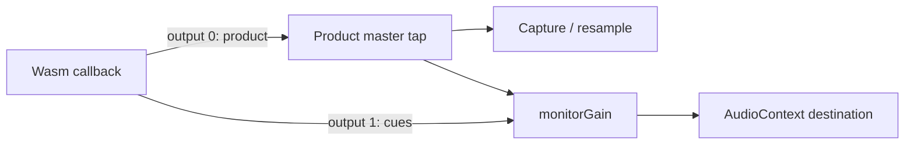

# Scheduled Pattern Record and count-in — S6 design addendum

## Outcome and authority

S6 supplies the complete native-to-Web capability needed by S7. From stopped,
Record with one or two count-in Bars keeps Pattern playback and recording off,
sounds four or eight monitoring clicks, then starts the Pattern at frame `S`.
An actual cancellation before the start claim leaves the transport stopped and
creates no recording Journal or Project change. Live Pads still sound during
count-in; their pre-start presses are never recorded.

The authority is the [Record/count-in decision](../prd/decisions/2026-10-10-record-key-and-count-in.md)
and [S6/S7 plan](../plans/2026-10-10-pattern-switch-and-count-in.md).
Global ● continues to record Pattern events on every page. Off and Record
while already playing retain the existing six-state behavior. Sample and
Performance recording keep their own entry points. S3 recording switches and
S5 phase-preserving switches remain later stages.

This addendum selects the scheduling, cancellation, I/O ownership and cue
route before implementation. Its preparation Task changes only this file and
the parent plan. It is not a receipt that S6 or S7 is implemented.

## Refreshed premises

Integration and preparation-worktree base:
`e220c98ca1b0f4a3c08646bfeb328ffa186a263d`.
Precommit integration refresh:
`bb9458976af8925dd93a2048d951ec7038bda98b` includes #2017's Build 89 snapshot
squash witness and #2018's Project v5 5.4.1 full-string `input_sequence`
validation fix/Build 90 cut (`bc76dc42…`), followed by #2020's Build 90 snapshot
squash witness only. The Contract fix rejects trailing newlines in canonical
decimal identity; it does not change the scheduled transport, Facade, SDK,
worklet or policy inputs inspected here. Preserve that stricter current
Contract on implementation's new base. Keep this preparation's older base
explicit; neither a Build 89 nor a Build 90 proof is claimed.

| Premise | Disposition at that base |
| --- | --- |
| Playing switches and three SEQ SNAP choices | Delivered through S1/S2 and S4, including #2015 squash `e220c98c…`. Preserve exact reservations, claimed successors, Stop and original Creator journeys. |
| Native scheduled Record | Outstanding. `PatternTransportCommand` still contains generation, epoch, Pattern binding, action and switch authorities, with no scheduled-start capability; `apply_pattern_transport` applies ordinary starts at a callback boundary. |
| No Journal during count-in | Outstanding. `PatternTransportCoordinator::request` synchronously reads/begins/prepares the Journal before submitting an ordinary Record command. The production factory owns Store and Journal on that control path. |
| Dedicated I/O executor | Already available. `PatternTransportExecutor` constructs, executes and destroys an owner on one thread and retains one exact work ticket. It is not wired into the production Pattern transport controller. Reuse it. |
| Existing Web proof | Preserve the real-OPFS global transport journey and executor-held-write/live press/release/shutdown/reacquire journey in `realtime_audio_worklet.spec.mjs`. They do not exercise a scheduled start or a production controller whose Journal opening is held after `S`. |
| Monitoring route | Already available. Runtime Session builds the product master tap before `monitorGain`; Creator clicks join downstream. Native worklet currently exposes one product output. A second monitoring-only output and its SDK consumer are outstanding. |
| #1958 / #1959 | Closed decision Issues, not feature completion. Their live comments adopt SEQ SNAP and global Pattern-only Record with Off/1/2 count-in; the earlier page-specific Record proposal is superseded. |
| F1 / #2014 | Concurrent peer-owned Engine/Audio Portal work, unmerged at this audit. Refresh its actual merge and current main before editing overlapping source; preserve both Filter and S4 behavior. |

Two private feasibility observations inform this choice. A fresh test-only
Wasm probe using the production executor and Web storage platform held the
actual OPFS immutable-write import: control made 20 further inspect turns,
then exact bytes were read back and the owner was destroyed on its original
thread before shutdown. A separate raw-PCM observer calibrated native frames
against AudioContext frames and retained samples through a main-JS stall.
These establish useful test/ownership methods. Neither proves the proposed
controller, count-in, cue routing, exact `S`, or a current product build.

## 1. Exact native timeline

Use a separate typed scheduled-Record capability. Retain the ordinary
`PatternTransportCommand`, receipt and observation layouts and old public
symbols. A companion request binds runtime generation, frame epoch,
transport epoch, a non-reused schedule serial, prepared Pattern identity and
generation, and `bars` (exactly 1 or 2). Unsupported ports explicitly refuse
this capability; they must not emulate it with a Host timer.

The engine chooses `C`, the first eligible sample in a nonempty callback after
any old Pattern release tail has become quiet. Eligibility concerns Pattern
voices, not live Pad or replay voices. Pin the prepared Pattern, BPM and
rounded Bar length `B`; check multiplication/addition before accepting the
schedule. Set `S = C + bars * B`. Pattern playback stays off throughout
`[C, S)`. At the sample `S`, the audio thread claims the start and sets origin
to `S` before evaluating Pattern events there. Live voices and the ordinary
Engine clock continue normally.

The callback-entry rendered frontier is not the current sample and cannot
decide a cancellation race. Tests must cover a long callback containing `S`.
No schedule may wrap frames, epochs or serials. Exhaustion refuses the new
schedule while preserving existing receipts/authorities and the ordinary
UINT64_MAX behavior.

Use the existing rounded Bar geometry; #1973 owns changing that policy. The
forced click boundaries are `C + bar * B + round(beat * B / 4)`, for beats
0–3 of each count-in Bar. Independent literal witnesses at 48 kHz, `C=1000`:

| BPM / Bars | Forced cue frames | `S` |
| --- | --- | --- |
| 120 / 1 | 1000, 25000, 49000, 73000 | 97000 |
| 129 / 2 (`B=89303`) | 1000, 23326, 45652, 67977, 90303, 112629, 134955, 157280 | 179606 |

Do not derive both producer and test expectations with the same rounding
helper. At 129 BPM the independently rounded eight-Beat value 179605 is not
this design's start frame.

## 2. Cancellation, receipts and lifetime

Implement one fixed scheduled-start cell in `RealtimeEngine`, separate from
the ordinary one-command queue. Its lock-free tagged state uses a 60-bit
monotone serial and four phase bits: Empty, Submitted, Preparing,
CancelPreparing, Armed, Starting, Applied, Cancelled, Failing and Refused.
Verify the atomic is lock-free on supported targets. Publish immutable
payload before Submitted with release ordering. Audio must exclusively claim
Submitted→Preparing before reading that payload. No allocation, mutex,
storage call or unbounded wait runs on audio.

`e1` is the reserved scheduled-Record epoch. Retain at most one second intent
`e2` for Record cancellation or Play/Stop; a third command is busy. A winning
cancel of Submitted or Armed publishes a cancelled receipt and can be
acknowledged without another callback. A cancel during Preparing marks
CancelPreparing; acknowledgment/reuse waits asynchronously for the audio
writer to finish. During Preparing, audio copies every bounded scalar schedule
and cue field into independent audio-owned storage and establishes a native
material borrow before publishing Armed. After Armed it never reads the
recyclable control cell's payload or its Pattern/material pointer again.
Construct the complete pointer-free cue descriptor from that local copy
before its tagged Armed→Armed commit. The CAS decides which lineage wins;
it does not protect a read performed after that CAS.

Logical Cancelled acknowledgment permits the control scalar slot to be reused,
but does not authorize material reclamation. A separate lock-free native
borrow/last-use fence retains material through all audio uses of the old
local copy, including a callback paused after a successful commit. Control
reclaims only after that fence and the existing voice/material lifetime
authorities settle; audio performs no destructor or heap reclamation. Accept
at most one new schedule lineage per callback. A new Submitted cell after
fast cancel/ack/rearm waits until the next callback, after the previous local
copy's last use. Control cannot overwrite that independent copy.

Armed→Starting at `S` is the start linearization point. If cancellation wins,
there is no applied start and no Journal. If that claim wins, a later Stop or
Record-off takes its real ordinary cutoff `F`: retain ordered `e1` and `e2`
receipts, and truth for `[S,F)`. Never relabel a lost cancellation as pre-start,
backdate `F`, overwrite `e1` with latest-only telemetry, or invent a zero-length
take. Journal failure after the start is an explicit failed opening followed
by an actual stop/settlement path; it is not a successful cancellation.

The schedule and receipt retain their exact Pattern/material binding until
acknowledgment, and independently through every remaining native borrow.
Quiescence includes the scheduled cell, retained receipts, those borrows,
ordinary command queue, voices and the cue-output consumer. Project/session
replacement and shutdown fence the old runtime generation, drain accepted
work and release pins only after that aggregate lifetime proof.

## 3. Facade I/O ownership and recording boundary

Reuse `PatternTransportExecutor` with one dedicated Store/Journal owner.
Construct, execute and destroy these collaborators and their leases on that
thread. Its factory may retain the immutable platform identity and shared
history/registry resources; it may not capture a mutable Application,
coordinator or a lease created on another thread. Keep the coordinator and
audio port serialized on control. Use the existing AuthoringHistory transaction
guard for shared history, preserving the active-controller registry lifetime.

During count-in, no Journal begin/open, admission preparation, Project write
or writer-lease operation is allowed. Arming uses the retained immutable
Project/Pattern binding. After acquiring the actual `e1` Applied receipt, the
I/O owner loads and validates the expected revision and ownership, begins the
Journal, prepares admission and applies a recording fence at exact `S`.
Conflicts discovered then produce truthful failure and an actual stop; the
implementation must not quietly open early to prevalidate them.

The existing executor's identity includes runtime generation, transport epoch,
command ID and monotonically increasing step. Retain its single work cell and
64 KiB metadata bound; do not carry a mutable Project or PCM in that payload.
Control submit/inspect/consume perform no I/O. An expired observation does
not cancel, repeat or consume an accepted operation. Reconcile its actual
completion once before consuming the ticket.

While opening or appending is held, control and live audio stay serviceable.
Retain candidates in native acceptance order with original runtime frame,
watermark, slot, velocity, correlation and native sequence. Classify a press
against the exact tagged start claim, not a callback-entry rendered frontier
that can already exceed `S`. A native admission authority acquired before
Armed→Starting keeps that press live-only even if queue latency makes its
voice sound later; its later release does not manufacture a recorded press.
Bind this authority to the real sequence and schedule serial before exposing
enqueue acceptance. For an accepted post-start press, reserve its release metadata
credit before enqueue. Publish success to the caller only after its total
native operation completion and required durable admission have both settled.

Use fixed ingress capacity derived from the existing
`audio::kRealtimeQueueCapacity` (`N`): `N` ordinary pending candidates plus
`N` reserved release credits, with separate retained `e1/e2` control cells.
The implementation must bind SDK/Host retained-ticket capacity to those same
credits. These are recording metadata credits, not free cells in the native
input FIFO. The opt-in input profile separately supplies a fixed `2N` physical
FIFO with at most `N` ordinary occupied/reserved entries and at most `N`
outstanding release reservations. Reserve a physical release credit before
accepting each held press; its matching release consumes that reserved credit
even when ordinary admission is full. Every entry retains one private
acceptance ordinal, so partitioned admission never reorders a release ahead
of its press. Refuse a new press before enqueue if either native input,
completion-ledger or recording-metadata capacity cannot be reserved.

Runtime Session negotiates this profile at quiescent generation activation,
before any live Pad input, not when count-in is requested. Live presses made
before count-in therefore already own their release reservations. A legacy
unnegotiated generation keeps its existing queue, DTOs and admission behavior;
switching profile with pending input/voices is busy, with no queue migration
or implicit discard. A press's terminal result does not retire its held
release reservations. Retire each resource exactly once at its own authority:

| Resource | Retirement authority |
| --- | --- |
| Ordinary native input occupancy | Audio has actually consumed that entry; its completion ticket can still remain retained. |
| Press-operation ticket/completion credit | Reconcile its native terminal effect and required durable press admission, then consume that exact ticket. Observation expiry alone is insufficient. |
| Native held-release escrow | Transfer the same reserved credit to its matching physical release entry, retaining it until native consumption/completion. An alternative requires actual input-owner revocation/quiescence and proof no outstanding physical or recording hold still needs that release. A muted/no-voice/toggle-stop press result or finished sound is insufficient. |
| Ordinary recording candidate credit | The I/O owner has durably retained and reconciled that exact candidate; an unknown write effect must still retain its ticket. |
| Held recording-release metadata/correlation | Its matching release is durably retained and settles the original recorded authority, or an actual authoring cutoff/supersession/owner disposition durably closes that hold and reconciles its stored prefix. Native voice silence or press completion is insufficient. |

A Record-off/Stop authoring cutoff can settle recording metadata while a
physical live hold still needs its native release escrow. Conversely, native
invalidation alone cannot erase a durably admitted recording hold. Preserve
each remaining owner independently, including muted, toggle-stopped and
invalidated presses; a failure frees held credits only after its explicit
owner disposition proves the corresponding obligation ended. Reserve→occupied
release transfer spends the same credit, not a second credit or early return.
Never discard a successful silent recorded press, synthesize a release, drop
its correlation, or exceed the fixed capacity to balance accounting.

Test native FIFO
saturation separately from metadata saturation, including accepted input
before count-in, partial drains, cancellation and original-deadline expiry.
Validate exact byte bounds, retry identities and exhaustion. Do not enlarge
the existing 16-slot Bridge RPC pool to hide a blocking dispatch.

The scheduled opening's original five-second budget starts once at the first
control acquisition of actual Applied evidence. It is not charged from the
initial count-in request: two Bars at 40 BPM last twelve seconds. Each Pad
operation retains its existing original deadline. Neither repeated inspect,
queued replay nor retry restarts either budget. Off and playing-overdub
opening deadlines remain unchanged.

Record-off and Stop retain all existing flush/reconcile/overlay/Project Truth
and crash/reopen legs. Shutdown requests executor drain without joining on
control; wait for actual stopped evidence before destruction. A finite RAM
ingress buffer is not crash durability or a promise to survive an infinite
storage stall.

## 4. Short Host admission turns and truthful SDK completion

Preserve the exact request and response key sets of the existing
`pattern.transport.request` and `pattern.transport.inspect` operations.
The current strict SDK rejects even an extra nullable status field. Count-in
uses separate companion operations: `pattern.transport.count-in.capabilities`,
`.request`, `.inspect` and `.cancel`, each with its own strict codec. The new
request selects `bars: 1 | 2` and Record from stopped; refuse it if recording
or another transport intent is pending, or the native schedule/cue capability
is unavailable. Creator Off and Record while playing use the old operation.

The companion inspection adds a typed `count_in` view. Before native arming
it contains `bars` with `start_frame: null`; once `C/S` are published it reports
their actual frame epoch and schedule identity. Native 60-bit serials and
64-bit epochs cross JS as canonical nonzero decimal strings, with whole-string
validation (including rejection of trailing LF/CRLF), exact native bounds,
and no leading zeros, truncation, implicit Number conversion or wrap. Frame Numbers require
an explicit safe-integer check; values beyond that range are refused rather
than rounded. Existing wire fields remain unchanged. Retain
applied/cancelled results by their ticket rather than dropping them when the
count-in view clears. Never use frame zero as an invented future origin.
The new companion distinguishes native start Applied from Journal opening
completion. S7 can make the Record lamp steady at the actual recording
boundary while opening remains pending; no UI state substitutes for durable
Pad success. Public native DTOs and the existing Facade port vtable remain unchanged;
use companion DTOs/capabilities and Pimpl state for the new path. New SDK→old
Host capability probing treats an unknown companion operation as explicit
count-in unsupported without poisoning the session or ordinary transport.
Old SDK→new Host ordinary responses remain byte-schema compatible. Companion
input/completion event streams are opt-in per generation; old consumers never
receive a new event kind. The existing protocol envelope version remains 1.

Choose a short admission ticket/query route for Pad recording. Reserve
metadata, enqueue the live input, bind its real native sequence and return a
bounded internal ticket on that dispatch turn. Query the retained result on
later short turns. The public scheduled-record trigger promise awaits a total
native operation completion and durable admission outside both `hostRequestTail` and
`runtimeActionTail`; internal queue acceptance is not public recording success.

The old trigger-outcome stream only reports voice start or capacity failure;
an accepted muted press or loop-toggle stop emits neither. Preserve that
stream and add a retained sequence-bound operation-completion companion for
the opt-in profile. Every accepted press/release reaches exactly one terminal
disposition: voice-started, voice-capacity, toggle-stopped, muted/no-voice,
release-applied, release-no-voice, or accepted-input-invalidated-before-consume.
Release receives its own nonzero operation sequence and names the matching
held-press sequence; never reinterpret the legacy zero release sequence.
Terminal success describes the actual effect, not an invented voice start.
Voice-capacity and invalidation are explicit failures with their required
recording disposition; no failed live operation silently becomes a recorded
success. Toggle-stop and intentional no-voice success still require any
applicable durable admission. Release settles against its press's actual
live-only/recorded authority. Each terminal path reconciles its operation
exactly once, including after observation expiry; the per-resource table above
governs credit retirement. Completing or consuming a held press's ticket must
leave its future native and recording release reservations intact.

Replace the scalar early-outcome reservation with a request/sequence-bound
ledger before allowing concurrent durable promises. Bind completions arriving
before the short enqueue response, consume each original ticket once, refuse
stale generation/session/epoch/sequence combinations, and preserve exact
replay identity. Stop, cancellation, inspect and accepted release retain their
reserved paths while a Journal write is held. Do not disable the Bridge's
Asyncify dispatch gate or run a second mutable controller concurrently.

Keep all existing immediate Record, playing overdub, ordinary trigger and
shutdown semantics when no scheduled Record is active. Migration of shared
Store/Journal lifecycle must preserve those paths and their original tests;
the new capability cannot make an old host depend on count-in support.

## 5. Monitoring-only native cues and complete Web consumer

Use the same Wasm audio callback for Pattern start and count-in cues. Copy a
bounded batch of at most eight forced markers and an optional start-downbeat
descriptor; no borrowed Pattern pointer or reusable cell reference crosses
into the output adapter. An Armed→Armed RMW linearizes each due cue against
cancellation. A cue already committed to the copied callback batch remains
valid if control later cancels, acknowledges and rearms that cell before
adapter consumption. A newly armed lineage does not replace copied markers.

Keep the current click sound: sine, normal 1200 Hz, accent 1800 Hz, gain 0.2,
40 ms exponential decay to 0.0001, then silence. Preinitialize its bounded
kernel. The mathematical phase begins at zero, so a marker at `C` has first
nonzero PCM at `C+1`. Cue markers, rendering and envelope retirement use the
native sample clock, not JS dispatch time.

The worklet offers an additive two-output startup API:

Runtime Session owns and connects both outputs. Cue output never reaches the
product master tap, capture, resample or rendered assets; it obeys downstream
monitor volume. Preserve the old one-output API and calling convention, direct
recovery and start idempotence. The new identity tuple includes context,
product tap and cue monitor destination; an incompatible repeat must not add
another audible route. A committed copied cue batch has independent lineage
and retirement bounds; cancel/ack/rearm of the latest control tag cannot erase
it. The copied batch records its committed render span and cancellation
watermark independently. Cancel retires uncommitted future markers and
uncommitted carried envelope spans at the actual native cutoff; the latest
control tag cannot suppress a span already owned by that copied batch.
Retain that batch through its adapter-consumption fence. Paused/shutdown paths explicitly settle both
that fence and the independent material borrow before destruction.
Legacy output-0-only hosts remain supported and
explicitly refuse count-in. Paused callbacks zero both outputs without advancing
the Engine clock. The real callback in-flight guard covers Engine rendering,
both output consumers and generation acknowledgment through quiescence.

Force exactly four or eight cues in `[C,S)`, regardless of the device
metronome toggle. At `S`, native emits the optional ordinary accented
downbeat only when the toggle snapshot is On. S7 supplies that device toggle
through a direct atomic capability and excludes the native-owned `S` downbeat
from the existing JS scheduler, preventing a ninth forced cue or a doubled
ordinary click. Subsequent ordinary metronome beats use the existing scheduler;
this design does not claim it survives an unbounded main-JS stall.

S6 includes this SDK graph consumer and packaged proof. A native producer,
telemetry descriptor or unused two-output startup symbol alone does not
complete S6. S7 subsequently owns device hydration, controls, countdown,
Record lamp and the Creator scheduler handoff.

## 6. Declared implementation ownership

Before code, refresh actual main/F1 integration and amend these declarations
if the exact owning source or necessary test seam differs. No undeclared
control-plane, product allocation or unrelated peer fix belongs to S6.

| Owner | Declared files |
| --- | --- |
| Native schedule / cue batch | `packages/audio-runtime/include/lmdj/audio/realtime_engine.hpp`, `src/realtime_engine.cpp`, new `include/lmdj/audio/scheduled_pattern_transport.hpp`, `packages/audio-runtime/CMakeLists.txt`; `tests/core/audio/realtime_engine_test.cpp`, `realtime_engine_stress_test.cpp`, `snapshot_publication_stress_test.cpp`, `long_sample_publication_stress_test.cpp`, new `pattern_count_in_stress_test.cpp`. |
| Worklet outputs / kernel | `packages/audio-runtime/include/lmdj/audio/web/realtime_audio_worklet.hpp`, `src/web/realtime_audio_worklet.cpp`; the bounded kernel stays private in that implementation. Web export/activation wiring in `packages/web-runtime-platform/src/bridge.cpp`, `src/web-runtime-pre.js`, and `CMakeLists.txt`. |
| Facade I/O and admission | `packages/application-facade/include/lmdj/facade/application.hpp`, `include/lmdj/facade/pattern_transport_controller.hpp`, `include/lmdj/facade/pattern_transport_ports.hpp`, new `include/lmdj/facade/scheduled_pattern_transport.hpp`, `internal/lmdj/facade/pattern_transport_controller_factory.hpp`, `src/pattern_transport_controller.hpp`, `src/pattern_transport_controller.cpp`, `src/pattern_transport_controller_factory.cpp`, `src/pattern_transport_executor.cpp`, `src/pattern_admission_controller.hpp`, `src/pattern_admission_controller.cpp`, `src/application.cpp`, new `src/pattern_transport_io_owner.hpp` and `.cpp`, `packages/application-facade/CMakeLists.txt`; `tests/core/facade/pattern_transport_test.cpp`, `pattern_transport_controller_test.cpp`, `pattern_transport_executor_test.cpp`, `pattern_admission_test.cpp`, new `pattern_count_in_stress_test.cpp`. |
| Host / Bridge / SDK | `packages/web-runtime-platform/src/control_runtime.cpp`, `src/bridge.cpp`, `src/web-runtime-pre.js`, `CMakeLists.txt`, `web/protocol.mjs`, `web/runtime_session.mjs`, `web/runtime_types.d.ts`, `test/control_runtime_test.cpp`, `test/runtime_session.test.mjs`, `test/protocol.test.mjs`, new `test/fixtures/legacy_pattern_transport_status.mjs` containing the frozen strict legacy response decoder. |
| Packaged proof | `tests/platform/web/audio/realtime_audio_worklet.spec.mjs`, `realtime_audio_worklet.html`, `paired_energy_probe.mjs`, new `native_frame_pcm_probe.mjs`; `packages/web-runtime-platform/test/pattern_transport_opfs_probe.cpp` and `.hpp`, with conformance wiring in the already-declared Bridge/JS/CMake files. Keep the PCM observer test-only. |
| Current documentation | This addendum and parent plan; `apps/docs-site/docs/core/modules/audio-runtime.mdx`, `application-facade.mdx`, `apps/docs-site/docs/platform/web-runtime.mdx`; `apps/docs-site/diagrams/audio-runtime.architecture.json`, `application-facade.architecture.json`, and their official `apps/docs-site/static/diagrams/` HTML/SVG outputs. |

Abbreviated paths in each row are relative to that row's package or test
directory. Entries marked new are future implementation files, not preparation
Task additions. The implementation remains one complete S6 Task with native producer, Facade
ownership, Host/SDK routing and cue consumer in its reviewable commit. Any
necessary preparatory Task or documented split has its own declared boundary;
it cannot be counted as completion of S6 while a consumer or journey is missing.

## 7. Verification and far-side assertions

Each reduced test fixes one fact. Use independent literal frame/PCM oracles
alongside producer/consumer agreement, and prove the shared defect is caught
with a fresh rebuilt artifact. Retain original budgets and all journey legs.

| Lowest owning tier | Required witness / defect caught |
| --- | --- |
| Native component | Pattern silent before `S`, old tail quiet before `C`, live Pads unaffected, exact event at `S`, noninteger BPM and two Bars, empty/long callbacks, no wrap. Catches callback-start or independently rounded wrong origin. |
| Native deterministic race + stress | Cancel at Submitted/Preparing/Armed, before/at/after `S`; pause after a successful cue/start commit but before the last material use, then cancel/ack/rearm and attempt reclamation, resume and consume the original batch. Assert independent copy, borrow fence, next-callback lineage admission, ordered `e1/e2`, third busy, failure and quiescent pin release. Catches false cancelled success, ABA, mixed lineage, dangling material and lost committed cues. |
| Native cue / worklet | Four/eight exact markers and PCM onsets, zero-first-sample kernel, cancellation between batch production and consumption, rearm, optional `S` downbeat, paused output and two-output quiescence. Catches cue duplication/loss or a consumer reading recycled state. |
| Facade component + integration | No pre-`S` Journal or writer mutation; winning cancel leaves complete Truth and storage unchanged. Actual Applied opens at `S`; pre-start press/post-start release is live-only, including a callback frontier beyond `S` before the start claim; post-start pair retains original frames and correlation. Catches speculative opening or early capture. |
| Facade held-I/O + stress | Hold begin and append separately; control/inspect/cancel/release continue. Saturate metadata and native FIFO independently, including a held pre-count-in press, partial drains and reserved release admission. Assert total completions for two loop-toggle presses, muted press, capacity failure, release/no-voice and invalidation before/after `S`; late completion/credits reconcile once. Retain the original five-second opening budget and original Pad operation deadline (currently one second), plus the 40-BPM two-Bar schedule. Catches inline I/O, hung no-voice promises, release starvation, duplicate effects or widened/reset deadlines. |
| Facade held silent input + persistence | Complete a post-`S` held muted/no-voice press's native result and durable admission, then consume its press ticket; both future release reservations must remain. Hold append and independently saturate ordinary FIFO, metadata and ticket capacity; matching physical release still uses its reserved native and metadata paths with original frame/correlation. Record-off/Stop → flush → reconcile → complete Truth → reopen must retain the actual correlated release duration, not the unreleased sixteenth-note default. Include toggle-stopped and invalidated/owner-cutoff dispositions, plus a held pre-count-in no-voice press's live-only release. Assert no leak/double return, no synthetic release and original deadlines. Catches premature recycling of held-release ownership after a silent press completes. |
| Facade persistence | Start → accepted post-`S` input → Record-off/Stop → flush → reconcile → overlay → complete Truth → reopen; opening/append failure → retry or terminal disposition → Stop → reopen; crash/recovery and shutdown drain retain the original owning journeys. Catches a green prefix hiding missing persisted events. |
| Host / SDK unit and component | Strict companion validation; frozen current strict SDK decoder accepts new Host ordinary responses; new SDK with old Host continues ordinary operations after unsupported probing. Nullable arming frame and actual lineage; decimal serial/epoch round trips above `2^53`, overflow/stale/replay rejection; total early completions including toggle/muted/release; independently pending durable promises; inspect/Stop/release while I/O held, session replacement and shutdown. Catches wire incompatibility, precision loss, serialized dispatch or fabricated durable success. |
| Packaged Wasm / OPFS integration | Exercise the actual scheduled production controller and public Runtime Session on the packaged Web Host. Hold its real post-`S` Journal begin/append import; retain live press/release outcomes, responsive inspect/Stop, exact recovered bytes, digest/length and complete Project Truth after reopen. Existing isolated executor proof is retained but cannot substitute. |
| Independent raw PCM | Calibrate native→AudioContext offset independently for each activation and frame epoch with a real known Bank onset, then capture product and cue outputs across `C/S`. Distinguish logical event frame `S` from first nonzero PCM: the current dry Bank attack has a zero first sample, so its first onset is `S+1` for that fixture; derive other expectations independently from their actual attack/kernel. Stall main JS over `S`; prove four/eight cue onsets (`C+1` etc.), the exact fixture Pattern onset, live-only early Pad audio, mute/monitor gain and zero cue energy in capture/resample. Catches a correct status with wrong/missing audio or a one-sample false oracle. Producer markers are not calibration evidence. |
| Compatibility | Preserve the existing Off/six-state, playing-overdub, switch/Stop, worklet activation/direct recovery, recording/capture/resample and persistence journeys. Run owning native/Facade/Host stress and the declared Web proof on the committed Task head. Catches regressions hidden by new-feature-only tests. |

S7 adds the original full Creator journeys for default/corrupt/late hydration,
Off/1/2, count-in cancellation by both physical controls, live Pads,
countdown/lamp, forced metronome and post-start toggle, global ● on every page,
Sample/Performance exclusion, Truth and reopen. Browser results remain distinct
from physical-device and hearing acceptance.

Record exact commands, selected tests, rebuilt source/artifact identities,
raw retained results, failures and explicit complete-verification gaps. Schedule
heavy native/Wasm/Creator runs with the peer coordinator; do not duplicate its
original full Creator proof or change workers, timeouts or journey selection.
For implementation shipping, the user's supplied AGENTS additionally requires
the committed-head evidence for every selected `batch_only` lane (or explicit
owner-accepted risk) and its exact-head premerge check. This documentation-only
preparation selects no such lane and supplies no product acceptance evidence.

## Version Management

Preparation Task: **Version impact: none** — design/plan only, no source,
manifest, public API, Contract or Product identity changes.

Implementation debt: **Audio Runtime MAJOR**. Its selected inline scheduled
cell changes the public concrete `RealtimeEngine` size/layout, even when all
old symbols and DTOs remain. It cannot be called an additive MINOR ABI change.
Facade and Web Runtime owe MINOR only while companion APIs/Pimpl additions
preserve existing public layouts/vtables, exact legacy response schemas and
unnegotiated event streams; the compatibility tests above are required evidence.
Otherwise
reassess the affected MAJOR debt before shipping. S7 owes Creator MINOR.
Record debt through the canonical coordinated settlement; this Task allocates
no version or Product Build.

Count-in remains device state. Pattern/Project Truth and persisted Journal
schemas are unchanged; no Contract SemVer debt is expected. If implementation
requires a persisted semantic change, stop that extension and resolve it in
this design before code rather than smuggling it into S6.

## Documentation Impact

Preparation Task: **Documentation impact: none** — only `docs/design/` and
`docs/plans/` describe future work; no current Portal page claims it delivered.

Implementation: **Documentation impact: required** on
`/core/modules/audio-runtime/`, `/core/modules/application-facade/` and
`/platform/web-runtime/`, with affected source diagrams regenerated by the
official tool and `scripts/docs-site.sh check`. S7 updates the two Creator
manual routes in its own Task. No immutable Product snapshot or release is
created by either feature Task.
