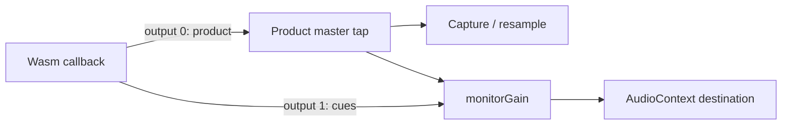

# Scheduled Pattern Record and count-in — S6 design addendum

## Outcome and authority

S6 supplies the complete native-to-Web capability needed by S7. From stopped,
Record with one or two count-in Bars keeps Pattern playback and recording off,
sounds four or eight monitoring clicks, then starts the Pattern at frame `S`.
An actual cancellation before the start claim leaves the transport stopped and
creates no recording Journal or Project change. Live Pads still sound during
count-in; their pre-start presses are never recorded.

The authority is the [Record/count-in decision](../prd/decisions/2026-10-10-record-key-and-count-in.md)
and [S6/S7 plan](../plans/2026-10-10-pattern-switch-and-count-in.md).
Global ● continues to record Pattern events on every page. Off and Record
while already playing retain the existing six-state behavior. Sample and
Performance recording keep their own entry points. S3 recording switches and
S5 phase-preserving switches remain later stages.

This addendum selects the scheduling, cancellation, I/O ownership and cue
route before implementation. Its preparation Task changes only this file and
the parent plan. It is not a receipt that S6 or S7 is implemented.

## Refreshed premises

Integration and preparation-worktree base:
`e220c98ca1b0f4a3c08646bfeb328ffa186a263d`.
Precommit integration refresh:
`bb9458976af8925dd93a2048d951ec7038bda98b` includes #2017's Build 89 snapshot
squash witness and #2018's Project v5 5.4.1 full-string `input_sequence`
validation fix/Build 90 cut (`bc76dc42…`), followed by #2020's Build 90 snapshot
squash witness only. The Contract fix rejects trailing newlines in canonical
decimal identity; it does not change the scheduled transport, Facade, SDK,
worklet or policy inputs inspected here. Preserve that stricter current
Contract on implementation's new base. Keep this preparation's older base
explicit; neither a Build 89 nor a Build 90 proof is claimed.

The implementation Task starts at actual `main`
`96802c0f8764d04cbf3d3c913e82292a01284ac9`. The preparation is delivered by
#2019; #2014's independent Filter is now merged at `a61ab819686ad896a3192e4a4bce1541ae55676d`.
Its typed accepted/applied state, epoch channel, quiescent reset and single
Filter stage must survive the Engine changes below. Current source still has
only ordinary callback-bound transport, control-owned production Store/Journal,
and one worklet product output: this refresh does not mark S6 implemented.

| Premise | Disposition at that base |
| --- | --- |
| Playing switches and three SEQ SNAP choices | Delivered through S1/S2 and S4, including #2015 squash `e220c98c…`. Preserve exact reservations, claimed successors, Stop and original Creator journeys. |
| Native scheduled Record | Outstanding. `PatternTransportCommand` still contains generation, epoch, Pattern binding, action and switch authorities, with no scheduled-start capability; `apply_pattern_transport` applies ordinary starts at a callback boundary. |
| No Journal during count-in | Outstanding. `PatternTransportCoordinator::request` synchronously reads/begins/prepares the Journal before submitting an ordinary Record command. The production factory owns Store and Journal on that control path. |
| Dedicated I/O executor | Already available. `PatternTransportExecutor` constructs, executes and destroys an owner on one thread and retains one exact work ticket. It is not wired into the production Pattern transport controller. Reuse it. |
| Existing Web proof | Preserve the real-OPFS global transport journey and executor-held-write/live press/release/shutdown/reacquire journey in `realtime_audio_worklet.spec.mjs`. They do not exercise a scheduled start or a production controller whose Journal opening is held after `S`. |
| Monitoring route | Already available. Runtime Session builds the product master tap before `monitorGain`; Creator clicks join downstream. Native worklet currently exposes one product output. A second monitoring-only output and its SDK consumer are outstanding. |
| #1958 / #1959 | Closed decision Issues, not feature completion. Their live comments adopt SEQ SNAP and global Pattern-only Record with Off/1/2 count-in; the earlier page-specific Record proposal is superseded. |
| F1 / #2014 | Merged at `a61ab819686ad896a3192e4a4bce1541ae55676d`, included in the implementation base above. Preserve its typed Filter accepted/applied channel, quiescent reset, single Filter stage and S4 behavior. |

Two private feasibility observations inform this choice. A fresh test-only
Wasm probe using the production executor and Web storage platform held the
actual OPFS immutable-write import: control made 20 further inspect turns,
then exact bytes were read back and the owner was destroyed on its original
thread before shutdown. A separate raw-PCM observer calibrated native frames
against AudioContext frames and retained samples through a main-JS stall.
These establish useful test/ownership methods. Neither proves the proposed
controller, count-in, cue routing, exact `S`, or a current product build.

## 1. Exact native timeline

Use a separate typed scheduled-Record capability. Retain the ordinary
`PatternTransportCommand`, receipt and observation layouts and old public
symbols. A companion request binds runtime generation, frame epoch,
transport epoch, a non-reused schedule serial, prepared Pattern identity and
generation, and `bars` (exactly 1 or 2). Unsupported ports explicitly refuse
this capability; they must not emulate it with a Host timer.

The engine chooses `C`, the first eligible sample in a nonempty callback after
any old Pattern release tail has become quiet. Eligibility concerns Pattern
voices, not live Pad or replay voices. Pin the prepared Pattern, BPM and
rounded Bar length `B`; check multiplication/addition before accepting the
schedule. Set `S = C + bars * B`. Pattern playback stays off throughout
`[C, S)`. At the sample `S`, the audio thread claims the start and sets origin
to `S` before evaluating Pattern events there. Live voices and the ordinary
Engine clock continue normally.

The callback-entry rendered frontier is not the current sample and cannot
decide a cancellation race. Tests must cover a long callback containing `S`.
No schedule may wrap frames, epochs or serials. Exhaustion refuses the new
schedule while preserving existing receipts/authorities and the ordinary
UINT64_MAX behavior.

Use the existing rounded Bar geometry; #1973 owns changing that policy. The
forced click boundaries are `C + bar * B + round(beat * B / 4)`, for beats
0–3 of each count-in Bar. Independent literal witnesses at 48 kHz, `C=1000`:

| BPM / Bars | Forced cue frames | `S` |
| --- | --- | --- |
| 120 / 1 | 1000, 25000, 49000, 73000 | 97000 |
| 129 / 2 (`B=89303`) | 1000, 23326, 45652, 67977, 90303, 112629, 134955, 157280 | 179606 |

Do not derive both producer and test expectations with the same rounding
helper. At 129 BPM the independently rounded eight-Beat value 179605 is not
this design's start frame.

## 2. Cancellation, receipts and lifetime

Implement one fixed scheduled-start cell in `RealtimeEngine`, separate from
the ordinary one-command queue. Its lock-free tagged state uses a 60-bit
monotone serial and four phase bits: Empty, Submitted, Preparing,
CancelPreparing, Armed, Starting, Applied, Cancelled, Failing and Refused.
Verify the atomic is lock-free on supported targets. Publish immutable
payload before Submitted with release ordering. Audio must exclusively claim
Submitted→Preparing before reading that payload. No allocation, mutex,
storage call or unbounded wait runs on audio.

`e1` is the reserved scheduled-Record epoch. Retain at most one second intent
`e2` for Record cancellation or Play/Stop; a third command is busy. A winning
cancel of Submitted or Armed publishes a cancelled receipt and can be
acknowledged without another callback. A cancel during Preparing marks
CancelPreparing; acknowledgment/reuse waits asynchronously for the audio
writer to finish. During Preparing, audio copies every bounded scalar schedule
and cue field into independent audio-owned storage and establishes a native
material borrow before publishing Armed. After Armed it never reads the
recyclable control cell's payload or its Pattern/material pointer again.
Construct the complete pointer-free cue descriptor from that local copy
before its tagged Armed→Armed commit. The CAS decides which lineage wins;
it does not protect a read performed after that CAS.

Logical Cancelled acknowledgment permits the control scalar slot to be reused,
but does not authorize material reclamation. A separate lock-free native
borrow/last-use fence retains material through all audio uses of the old
local copy, including a callback paused after a successful commit. Control
reclaims only after that fence and the existing voice/material lifetime
authorities settle; audio performs no destructor or heap reclamation. Accept
at most one new schedule lineage per callback. A new Submitted cell after
fast cancel/ack/rearm waits until the next callback, after the previous local
copy's last use. Control cannot overwrite that independent copy.

Armed→Starting at `S` is the start linearization point. If cancellation wins,
there is no applied start and no Journal. If that claim wins, a later Stop or
Record-off takes its real ordinary cutoff `F`: retain ordered `e1` and `e2`
receipts, and truth for `[S,F)`. Never relabel a lost cancellation as pre-start,
backdate `F`, overwrite `e1` with latest-only telemetry, or invent a zero-length
take. Journal failure after the start is an explicit failed opening followed
by an actual stop/settlement path; it is not a successful cancellation.

The schedule and receipt retain their exact Pattern/material binding until
acknowledgment, and independently through every remaining native borrow.
Quiescence includes the scheduled cell, retained receipts, those borrows,
ordinary command queue, voices and the cue-output consumer. Project/session
replacement and shutdown fence the old runtime generation, drain accepted
work and release pins only after that aggregate lifetime proof.

An exceptional direct quiescent stop before `S`, without a real winning
cancellation intent, returns `e1` Refused with no effective or origin frame.
It must not fabricate cancellation success. A real winning pre-start cancel
keeps its original Cancelled evidence across that stop; both paths retain
their independent receipts and resource obligations until acknowledgment.

Normal Host shutdown submits and settles the genuine ordinary `e2` cutoff
before quiescent Engine stop. If an exceptional direct quiescent stop
invalidates a lost-cancel intent before `e2` was submitted, preserve `e1`
Applied and terminate only that unsent intent as Refused, with no effective
or origin frame and no ordinary-epoch advancement. This is failed owner
invalidation, never cancellation success, a zero-length take or proof of
Journal closure. An already-submitted `e2` keeps its actual application
evidence. Refusal does not acknowledge or reclaim the independent native,
cue, accepted-input or held-release obligations.

The retained original second intent may first arrive after that exceptional
stop. An exact generation/frame-epoch/serial/e2 request against the retained
Applied cell must then establish the same Refused/null-frame evidence when
no ordinary command or real F exists. Refusing a subsequent ordinary submit
as `not_running` alone cannot settle that retained intent. The Facade copies
the refusal and clears only its matching unsent deferred cutoff; it preserves
e1 as the authoring epoch, the original error and the real owner-lost worker
disposition. This cleanup must not spend e2 or overwrite the failed phase.

### Reusing an engagement across takes

Each ordinary Record admission owns its original opening timestamp from the
start of preparation. A previous settled count-in opening cannot supply its
five-second guard. Keep the matching immutable work/publication evidence and
the unchanged opening-only deadline. Ordinary opening success or refusal must
not alter a retained scheduled caller ticket's request, receipts, opening
flags or error. Only the matching scheduled operation owns that status.

A locally admitted input ticket's inspect/consume continuation must remain
serviceable while a lifecycle RPC awaits its actual caller consumption. It is
serialized per original ticket independently of the ordinary Host request
tail. New admissions and unknown tickets retain ordinary request ordering.
This continuation does not invent completion, reset an observer's deadline,
consume another owner, or replace physical last-use/retirement barriers.

## 3. Facade I/O ownership and recording boundary

Reuse `PatternTransportExecutor` with one dedicated Store/Journal owner.
Construct, execute and destroy these collaborators and their leases on that
thread. Its factory may retain the immutable platform identity and shared
history/registry resources; it may not capture a mutable Application,
coordinator or a lease created on another thread. Keep the coordinator and
audio port serialized on control. Use the existing AuthoringHistory transaction
guard for shared history, preserving the active-controller registry lifetime.

During count-in, no Journal begin/open, admission preparation, Project write
or writer-lease operation is allowed. Arming uses the retained immutable
Project/Pattern binding. After acquiring the actual `e1` Applied receipt, the
I/O owner loads and validates the expected revision and ownership, begins the
Journal, prepares admission and applies a recording fence at exact `S`.
Conflicts discovered then produce truthful failure and an actual stop; the
implementation must not quietly open early to prevalidate them.

The existing executor's identity includes runtime generation, transport epoch,
command ID and monotonically increasing step. Retain its single work cell and
64 KiB metadata bound; do not carry a mutable Project or PCM in that payload.
Control submit/inspect/consume perform no I/O. An expired observation does
not cancel, repeat or consume an accepted operation. Reconcile its actual
completion once before consuming the ticket.

While opening or appending is held, control and live audio stay serviceable.
Retain candidates in native acceptance order with original runtime frame,
watermark, slot, velocity, correlation and native sequence. Classify a press
against the exact tagged start claim, not a callback-entry rendered frontier
that can already exceed `S`. A native admission authority acquired before
Armed→Starting keeps that press live-only even if queue latency makes its
voice sound later; its later release does not manufacture a recorded press.
Bind this authority to the real sequence before exposing enqueue acceptance.
The native authority's zero serial/epoch with `recording=false` explicitly
means there is no recording lineage; a pre-start or pre-count-in press must
not acquire a fabricated recording serial merely because a schedule is pending.
The retained Host/Facade ticket keeps its generation, frame epoch, sequence,
held-press correlation and, when applicable, the separate pending schedule
context. A post-start recording authority carries the actual schedule serial
and transport epoch. Its later release preserves the original authority even
after the press ticket is consumed or Record-off closes recording metadata.
For an accepted post-start press, reserve its release metadata
credit before enqueue. Publish success to the caller only after its total
native operation completion and required durable admission have both settled.

Use fixed ingress capacity derived from the existing
`audio::kRealtimeQueueCapacity` (`N`): `N` ordinary pending candidates plus
`N` reserved release credits, with separate retained `e1/e2` control cells.
The implementation must bind SDK/Host retained-ticket capacity to those same
credits. These are recording metadata credits, not free cells in the native
input FIFO. The opt-in input profile separately supplies a fixed `2N` physical
FIFO with at most `N` ordinary occupied/reserved entries and at most `N`
outstanding release reservations. Reserve a physical release credit before
accepting each held press; its matching release consumes that reserved credit
even when ordinary admission is full. Every entry retains one private
acceptance ordinal, so partitioned admission never reorders a release ahead
of its press. Refuse a new press before enqueue if either native input,
completion-ledger or recording-metadata capacity cannot be reserved.

Runtime Session negotiates this profile at quiescent generation activation,
before any live Pad input, not when count-in is requested. Live presses made
before count-in therefore already own their release reservations. A legacy
unnegotiated generation keeps its existing queue, DTOs and admission behavior;
switching profile with pending input/voices is busy, with no queue migration
or implicit discard. A press's terminal result does not retire its held
release reservations. Retire each resource exactly once at its own authority:

| Resource | Retirement authority |
| --- | --- |
| Ordinary native input occupancy | Audio has actually consumed that entry; its completion ticket can still remain retained. |
| Press-operation ticket/completion credit | Reconcile its native terminal effect and required durable press admission, then consume that exact ticket. Observation expiry alone is insufficient. |
| Host count-in receipt ticket | The real caller consumes the exact retained ticket. The normal path still requires its actual terminal start/cancel and completed opening/close evidence. An exceptional failed path additionally requires the real owner-loss disposition and owner ACK, stopped Native with complete scheduled/input quiescence, and all input consumers settled; consumption preserves the original failed receipts/error and never invents `F` or successful cancellation. |
| Native held-release escrow | Transfer the same reserved credit to its matching physical release entry, retaining it until native consumption/completion. An alternative requires actual input-owner revocation/quiescence and proof no outstanding physical or recording hold still needs that release. A muted/no-voice/toggle-stop press result or finished sound is insufficient. |
| Ordinary recording candidate credit | The I/O owner has durably retained and reconciled that exact candidate; an unknown write effect must still retain its ticket. |
| Held recording-release metadata/correlation | Its matching release is durably retained and settles the original recorded authority, or an actual authoring cutoff/supersession/owner disposition durably closes that hold and reconciles its stored prefix. Native voice silence or press completion is insufficient. |

A known final opening-deadline refusal after actual S and Stop F is a separate
running logical-consumption path. It retains the original complete identity,
final error and Journal, known I/O completion, real held Release and every
input consumer, cue and schedule pin/borrow condition. It must not call the
quiescent-only Engine query while callbacks run. The serialized-control-safe
`scheduled_pattern_record_settled(generation, frame_epoch, serial)` requires
the exact current monotonic lineage and an acquire read of audio's completed
last-use publication. Audio clears its marker at callback entry, and publishes
only at the end, after actual voice tails have finished, its schedule borrow
has ended, and cue consumer ACK has cleared pending ownership. Accepted input
and a new schedule invalidate prior publication. Completion consumption, a
queue size or zero-voice telemetry does not supply this proof. This permits
only consuming failed caller evidence; future callbacks may still begin.
Physical owner disposal, Native stop and reclamation continue to require their
independent actual callback-last-use barrier and quiescent-only lifecycle APIs.

A Record-off/Stop authoring cutoff can settle recording metadata while a
physical live hold still needs its native release escrow. Conversely, native
invalidation alone cannot erase a durably admitted recording hold. Preserve
each remaining owner independently, including muted, toggle-stopped and
invalidated presses; a failure frees held credits only after its explicit
owner disposition proves the corresponding obligation ended. Reserve→occupied
release transfer spends the same credit, not a second credit or early return.
Never discard a successful silent recorded press, synthesize a release, drop
its correlation, or exceed the fixed capacity to balance accounting.

Test native FIFO
saturation separately from metadata saturation, including accepted input
before count-in, partial drains, cancellation and original-deadline expiry.
Validate exact byte bounds, retry identities and exhaustion. Do not enlarge
the existing 16-slot Bridge RPC pool to hide a blocking dispatch.

The scheduled opening's original five-second budget starts once at the first
control acquisition of actual Applied evidence. It is not charged from the
initial count-in request: two Bars at 40 BPM last twelve seconds. Each Pad
operation retains its existing original deadline. Neither repeated inspect,
queued replay nor retry restarts either budget. Off and playing-overdub
opening deadlines remain unchanged.

The owner confirmed on 2026-10-11 that this five-second limit applies only to
opening the recording (see the [product decision](../prd/decisions/2026-10-10-record-key-and-count-in.md)).
Keep the original strict boundary: a first admission activation at 4999 ms may
open, but an admission still unopened at 5000 ms must remain closed and must
not acknowledge the Native receipt as a successful opening. A retained
admission fence proves that the recording already opened; its exact immutable
replay after the deadline does not create a new opening or renew the budget.
After activation, elapsed opening time cannot close the take or classify its
original correlated Press/Release as live-only. Preserve the real durable
release during I/O backlog until Record-off/Stop's actual cutoff and closure;
capacity, byte bounds, storage failure and owner-loss handling remain intact.

Record-off and Stop retain all existing flush/reconcile/overlay/Project Truth
and crash/reopen legs. Shutdown requests executor drain without joining on
control; wait for actual stopped evidence before destruction. A finite RAM
ingress buffer is not crash durability or a promise to survive an infinite
storage stall.

Resource-owner acknowledgment does not consume the caller's count-in receipt.
Terminal destruction also waits for that exact Host ticket to be consumed
through the existing public inspect operation. Keep the normal successful
close/consume/shutdown journey and the exceptional owner-loss/consume journey
as separate far-side witnesses; a failed phase or expired observer is not
terminal readiness.

## 4. Short Host admission turns and truthful SDK completion

Preserve the exact request and response key sets of the existing
`pattern.transport.request` and `pattern.transport.inspect` operations.
The current strict SDK rejects even an extra nullable status field. Count-in
uses separate companion operations: `pattern.transport.count-in.capabilities`,
`.request`, `.inspect` and `.cancel`, each with its own strict codec. The new
request selects `bars: 1 | 2` and Record from stopped; refuse it if recording
or another transport intent is pending, or the native schedule/cue capability
is unavailable. Creator Off and Record while playing use the old operation.

The companion request returns a pending admission/arming ticket promptly on
that dispatch turn, following the ordinary transport's short admission route.
Waiting for `S`, Journal opening or public operation completion happens outside
both SDK dispatch tails. Inspect, Pad press/release, cancellation and Stop must
remain serviceable during the full 40-BPM, two-Bar, twelve-second schedule;
moving the opening deadline alone does not prove this control responsiveness.

The companion inspection adds a typed `count_in` view. Before native arming
it contains `bars` with `start_frame: null`; once `C/S` are published it reports
their actual frame epoch and schedule identity. Native 60-bit serials and
64-bit epochs cross JS as canonical nonzero decimal strings, with whole-string
validation (including rejection of trailing LF/CRLF), exact native bounds,
and no leading zeros, truncation, implicit Number conversion or wrap. Frame Numbers require
an explicit safe-integer check; values beyond that range are refused rather
than rounded. Existing wire fields remain unchanged. Retain
applied/cancelled results by their ticket rather than dropping them when the
count-in view clears. Never use frame zero as an invented future origin.
The new companion distinguishes native start Applied from Journal opening
completion. S7 can make the Record lamp steady at the actual recording
boundary while opening remains pending; no UI state substitutes for durable
Pad success. Public native DTOs and the existing Facade port vtable remain unchanged;
use companion DTOs/capabilities and Pimpl state for the new path. New SDK→old
Host capability probing treats an unknown companion operation as explicit
count-in unsupported without poisoning the session or ordinary transport.
Old SDK→new Host ordinary responses remain byte-schema compatible. Companion
input/completion event streams are opt-in per generation; old consumers never
receive a new event kind. The existing protocol envelope version remains 1.

Bridge continuation ownership comes from the exact retained Runtime request,
not public error details. Public redaction removes private pending/reason/ticket
metadata. An accepted legacy Pad request keeps its actual retained input cell;
a lifecycle barrier records its pending result against that same RequestId and
operation before normalization. Neither another request nor a terminal refusal
may acquire that continuation. The original 16-slot RPC cell and absolute
deadline remain until the real result and response-consumption path settle.
Consuming an expired observer removes its continuation ownership, even while
its accepted candidate and I/O effect remain retained. A later RPC reusing that
RequestId receives its own refusal; it cannot inherit the old timeout/result.

Choose a short admission ticket/query route for Pad recording. Reserve
metadata, enqueue the live input, bind its real native sequence and return a
bounded internal ticket on that dispatch turn. Query the retained result on
later short turns. The public scheduled-record trigger promise awaits a total
native operation completion and durable admission outside both `hostRequestTail` and
`runtimeActionTail`; internal queue acceptance is not public recording success.

The old trigger-outcome stream only reports voice start or capacity failure;
an accepted muted press or loop-toggle stop emits neither. Preserve that
stream and add a retained sequence-bound operation-completion companion for
the opt-in profile. Every accepted press/release reaches exactly one terminal
disposition: voice-started, voice-capacity, toggle-stopped, muted/no-voice,
release-applied, release-no-voice, or accepted-input-invalidated-before-consume.
Release receives its own nonzero operation sequence and names the matching
held-press sequence; never reinterpret the legacy zero release sequence.
Terminal success describes the actual effect, not an invented voice start.
Voice-capacity and invalidation are explicit failures with their required
recording disposition; no failed live operation silently becomes a recorded
success. Toggle-stop and intentional no-voice success still require any
applicable durable admission. Release settles against its press's actual
live-only/recorded authority. Each terminal path reconciles its operation
exactly once, including after observation expiry; the per-resource table above
governs credit retirement. Completing or consuming a held press's ticket must
leave its future native and recording release reservations intact.

Replace the scalar early-outcome reservation with a request/sequence-bound
ledger before allowing concurrent durable promises. Bind completions arriving
before the short enqueue response, consume each original ticket once, refuse
stale generation/session/epoch/sequence combinations, and preserve exact
replay identity. Stop, cancellation, inspect and accepted release retain their
reserved paths while a Journal write is held. Do not disable the Bridge's
Asyncify dispatch gate or run a second mutable controller concurrently.

Keep all existing immediate Record, playing overdub, ordinary trigger and
shutdown semantics when no scheduled Record is active. Migration of shared
Store/Journal lifecycle must preserve those paths and their original tests;
the new capability cannot make an old host depend on count-in support.

Exceptional retirement separates the original operational failure from a
positive physical receipt. The existing five-field audio coordinator remains
unchanged; a nonvirtual companion seals Worklet admission and observes actual
admitted callback-body last use. Native stop and held-owner revocation wait
for that receipt. A terminal gate with a live body, a timed-out wait, or a cue
batch whose consumer has not acknowledged its actual copy cannot authorize
stop, Pattern/material reclamation or caller acknowledgment. The guarded Web
witness holds the same real callback after cue take and again before its last
body use; expiry invalidates the witness. Backend/node/context destruction
remains a separate obligation even after a positive body receipt.

After normal transport failure, optional `sendRetained` uses the existing
version-1 envelopes only for exact retained input inspect/release, count-in
inspect/cancel and session inspect. It grants no new press, scheduled request,
generation negotiation or replay. Original deadlines and first failures remain;
`pending: false` proves only that this new RPC was not admitted. An unknown
submitted count-in retains its exact pre-dispatch identity and reconciles
outside both SDK tails without resubmission. Caller consume still requires
the real terminal original ticket and Host consume gate; Native stop alone
is not caller consume. Known successful tickets keep explicit normal consume
semantics until terminal cleanup.

The terminal channel drives one actual serialized control retirement turn.
All Native, cue, held-input, caller and I/O-owner debts, plus every original
Bridge response/release thunk, must settle before transferring its owner.
Close retained RPC admission against a concurrent submit before that transfer.
The existing five-second timer retries this same request; timer expiry and
channel failure never authorize Worker termination. Browser cleanup requires
the authenticated native consume-release result exactly 1, retained RPC
consumers settled and a sticky positive receipt. The finite retained RPC budget
matches the existing 16 Bridge slots. Backend teardown propagates real formal
retirement and AudioContext-close failures rather than manufacturing closure.
These implementation drafts require current-artifact tests; this design does
not constitute their acceptance.

## 5. Monitoring-only native cues and complete Web consumer

Use the same Wasm audio callback for Pattern start and count-in cues. Copy a
bounded batch of at most eight forced markers and an optional start-downbeat
descriptor; no borrowed Pattern pointer or reusable cell reference crosses
into the output adapter. An Armed→Armed RMW linearizes each due cue against
cancellation. A cue already committed to the copied callback batch remains
valid if control later cancels, acknowledges and rearms that cell before
adapter consumption. A newly armed lineage does not replace copied markers.

Keep the current click sound and cadence: each count-in Bar's first beat is
accented, as in the existing metronome; its other three beats are normal.
Use sine, normal 1200 Hz, accent 1800 Hz, gain 0.2,
40 ms exponential decay to 0.0001, then silence. Preinitialize its bounded
kernel. The mathematical phase begins at zero, so a marker at `C` has first
nonzero PCM at `C+1`. Cue markers, rendering and envelope retirement use the
native sample clock, not JS dispatch time.

The worklet offers an additive two-output startup API:

Runtime Session owns and connects both outputs. Cue output never reaches the
product master tap, capture, resample or rendered assets; it obeys downstream
monitor volume. Preserve the old one-output API and calling convention, direct
recovery and start idempotence. The new identity tuple includes context,
product tap and cue monitor destination; an incompatible repeat must not add
another audible route. A committed copied cue batch has independent lineage
and retirement bounds; cancel/ack/rearm of the latest control tag cannot erase
it. The copied batch records its committed render span and cancellation
watermark independently. Cancel retires uncommitted future markers and
uncommitted carried envelope spans at the actual native cutoff; the latest
control tag cannot suppress a span already owned by that copied batch.
Retain that batch through its adapter-consumption fence. Paused/shutdown paths explicitly settle both
that fence and the independent material borrow before destruction.
Legacy output-0-only hosts remain supported and
explicitly refuse count-in. Paused callbacks zero both outputs without advancing
the Engine clock. The real callback in-flight guard covers Engine rendering,
both output consumers and generation acknowledgment through quiescence.

Force exactly four or eight cues in `[C,S)`, regardless of the device
metronome toggle. At `S`, native emits the optional ordinary accented
downbeat only when the toggle snapshot is On. S7 supplies that device toggle
through a direct atomic capability and excludes the native-owned `S` downbeat
from the existing JS scheduler, preventing a ninth forced cue or a doubled
ordinary click. Subsequent ordinary metronome beats use the existing scheduler;
this design does not claim it survives an unbounded main-JS stall.

S6 includes this SDK graph consumer and packaged proof. A native producer,
telemetry descriptor or unused two-output startup symbol alone does not
complete S6. S7 subsequently owns device hydration, controls, countdown,
Record lamp and the Creator scheduler handoff.

## 6. Declared implementation ownership

Before code, refresh actual main/F1 integration and amend these declarations
if the exact owning source or necessary test seam differs. No undeclared
control-plane, product allocation or unrelated peer fix belongs to S6.

| Owner | Declared files |
| --- | --- |
| Native schedule / cue batch | `packages/audio-runtime/include/lmdj/audio/realtime_engine.hpp`, `src/realtime_engine.cpp`, new `include/lmdj/audio/scheduled_pattern_transport.hpp`, `packages/audio-runtime/CMakeLists.txt`; `tests/core/audio/realtime_engine_test.cpp`, `realtime_engine_stress_test.cpp`, `snapshot_publication_stress_test.cpp`, `long_sample_publication_stress_test.cpp`, new `pattern_count_in_stress_test.cpp`. |
| Worklet outputs / kernel | `packages/audio-runtime/include/lmdj/audio/web/realtime_audio_worklet.hpp`, `src/web/realtime_audio_worklet.cpp`; the bounded kernel stays private in that implementation. Web export/activation wiring in `packages/web-runtime-platform/src/bridge.cpp`, `src/web-runtime-pre.js`, and `CMakeLists.txt`. |
| Facade I/O and admission | `packages/application-facade/include/lmdj/facade/application.hpp`, `include/lmdj/facade/pattern_transport_controller.hpp`, `include/lmdj/facade/pattern_transport_ports.hpp`, new `include/lmdj/facade/scheduled_pattern_transport.hpp`, `internal/lmdj/facade/pattern_transport_controller_factory.hpp`, `src/pattern_transport_controller.hpp`, `src/pattern_transport_controller.cpp`, `src/pattern_transport_controller_factory.cpp`, `src/pattern_transport_executor.cpp`, `src/pattern_admission_controller.hpp`, `src/pattern_admission_controller.cpp`, `src/application.cpp`, new `src/pattern_transport_io_owner.hpp` and `.cpp`, `packages/application-facade/CMakeLists.txt`; `tests/core/facade/pattern_transport_test.cpp`, `pattern_transport_controller_test.cpp`, `pattern_transport_executor_test.cpp`, `pattern_admission_test.cpp`, new `pattern_count_in_stress_test.cpp`. |
| Saturated durable input reduction | `packages/project-io/src/sequence_admission_codec.cpp`, `src/sequence_journal.cpp`, `tests/core/project_io/sequence_journal_test.cpp`, and the already-declared admission owner/header/I/O owner and admission tests. Reduce redundant candidate re-encoding, historical receipt searches and byte-confirmed immutable parsing only; preserve both actual fresh reads, the under-writer-lease replay, exact retries and collisions, actual durable syncs, all capacity/deadline rules and the original 1024-input journey. The unchanged component/stress budgets are the defect witnesses; no throughput acceptance follows from a source-only draft. |
| Fresh Native Journal layout | Additionally declare `packages/project-io/include/lmdj/project_io/storage_platform.hpp`, `src/native/storage_platform.cpp`, `src/testing_hooks.hpp` and `tests/core/project_io/storage_platform_contract_test.cpp`, plus the already-declared Sequence Journal, real Facade count-in fixture and Project I/O Portal page. Add independent optional `ProjectJournalLayoutValidator` without changing the existing storage vtable. Only Sequence checked reads discover it; absent capability retains the full original helper; Sequence begin retains its original entry layout check and Performance retains the original helper, while supported failure remains failure. An existing active-Sequence error-details lookup during begin still uses the Sequence checked-read path. Native repeats full secure tree validation, all eight typed directories, locked regular manifest/length checks and final named-root identity readback with per-call descriptors. No cached authority, durability receipt or atomic whole-tree view. A private test-only post-layout hook forces actual root replacement; a separate in-lock hook lets a genuine independent manifest descriptor prove shared coexistence, exclusive refusal and post-return release. Existing storage ownership and strict unsafe-layout/root-replacement/shared-lock/routing witnesses are the lowest-tier checks; original Journal/Facade owners and 30/300-second budgets remain. |
| Host / Bridge / SDK | `packages/web-runtime-platform/include/lmdj/web_runtime/control_runtime.hpp`, `src/control_runtime.cpp`, `src/bridge.cpp`, `src/web-runtime-pre.js`, `CMakeLists.txt`, `web/protocol.mjs`, `web/runtime_session.mjs`, `web/runtime_types.d.ts`, `web/runtime_loader.mjs`, `test/control_runtime_test.cpp`, `test/runtime_session.test.mjs`, `test/runtime_loader.test.mjs`, `test/protocol.test.mjs`, new `test/fixtures/legacy_pattern_transport_status.mjs` containing the frozen strict legacy response decoder. The output and physical-retirement capabilities use separate companion accessors; the existing audio-coordinator struct stays unchanged. |
| Packaged proof | `tests/platform/web/audio/realtime_audio_worklet.spec.mjs`, `realtime_audio_worklet.html`, `paired_energy_probe.mjs`; new `tests/platform/web/audio/count_in_pcm_probe.js` and `count_in_observer_server_test.py`; new `tests/platform/web/creator/creator_web_count_in.spec.mjs`, `creator/fixtures/count_in_helpers.mjs`, and existing `creator/fixtures/creator_audio.mjs`; `scripts/creator-web.sh` and `tools/web-runtime/serve_distribution.py` for one explicit proof-only observer endpoint while retaining ordinary asset verification. `packages/web-runtime-platform/test/pattern_transport_opfs_probe.cpp` and `.hpp` retain the isolated T0 witness and separately instrument the actual production controller, with conformance wiring in the already-declared Bridge/JS/CMake files. Keep observers and I/O latches test-only. |
| Current documentation | This addendum and parent plan; `apps/docs-site/docs/core/modules/audio-runtime.mdx`, `application-facade.mdx`, `project-io.mdx`, `web-runtime-platform.mdx`, `apps/docs-site/docs/platform/web-runtime.mdx`; `apps/docs-site/diagrams/audio-runtime.architecture.json`, `application-facade.architecture.json`, `web-runtime-platform.architecture.json`, and their official `apps/docs-site/static/diagrams/` HTML/SVG outputs. |

Abbreviated paths in each row are relative to that row's package or test
directory. Entries marked new are future implementation files, not preparation
Task additions. The implementation remains one complete S6 Task with native producer, Facade
ownership, Host/SDK routing and cue consumer in its reviewable commit. Any
necessary preparatory Task or documented split has its own declared boundary;
it cannot be counted as completion of S6 while a consumer or journey is missing.

The refreshed implementation also declares
`packages/audio-runtime/src/testing_hooks.hpp` for deterministic scheduling,
commit/consume and reclamation race witnesses, and root `CMakeLists.txt` for
owning test-tier registration. The coordinator owns the root registration;
native and Facade workers own separate package/test files. These seams do not
permit reduced budgets, omitted original journeys or a new unrelated gate.
`packages/web-runtime-platform/test/performance_bridge_test.cpp` also retains
the original eight-callback Pattern transport cadence journey while awaiting
real dedicated-I/O completion, with the original Performance launch coverage.
The Native Host fixture uses a nonvirtual `ControlRuntimePatternIoAccess`
companion in the already-declared Runtime header/source to observe real Facade
worker readiness and consumed work before each original audio leg, within its
existing two-second test wait. It does not add an RPC, mutate an owner, invent
an I/O receipt, increase the eight legs or expand a production deadline.
Legacy Native Hosts that do not install the physical capability keep their
existing successful operational quiescence receipt after a real Native stop.
Stopped telemetry alone cannot retire the deferred stop, and this compatibility
path is unavailable whenever a physical producer is installed. Native fixtures
bind the operational receipt to actual callback-thread join; it is separate
from the production worklet's physical last-use proof.

The guarded real callback witness also declares
`packages/audio-runtime/src/realtime_engine_audio_access.hpp` for a read-only
acquire load of the actual Native cue-pending batch identity. Its adapter,
Bridge and JavaScript conformance accessors stay inside the existing guarded
exports and are stripped from ordinary packages. The historical captured cue
ID alone is not ownership proof. Stage one requires that actual pending ID;
stage two requires cue retirement while the callback's final body borrow is
still retained. Its operational wait runs on serialized control against the
real held callback, without the older artificial in-flight probe.

The proof consumer uses the same public frozen Creator Runtime Session and
observes its actual Native product, cue and monitor signals through a separate
silent AudioWorklet. Its opt-in local server endpoint snapshots only the named
observer bytes; ordinary hashed assets, CSP and the default server remain under
the original verifier. The original eight Creator proof groups, worker counts
and deadlines remain. The observer routing unit catches accidental asset-gate
bypass; the initial five Creator cases and a mixed Bank/cue case catch wrong
PCM boundaries, cue leakage, speculative storage, or lost correlated silent-input duration. These source
drafts have no executable acceptance yet.

For the separate held-OPFS witness, the implementation additionally declares
new `packages/application-facade/internal/lmdj/facade/pattern_transport_io_testing.hpp`
and a conformance-only callback in the already-declared I/O owner source and
Facade CMake. The callback instruments the actual production owner's next
`open` or `admit` work on its own worker; it does not create a second executor,
replace audio, invent a receipt, or alter ordinary production builds. The Web
test probe separately holds the opening Journal's real immutable write and an
admission append after write and before its actual flush, on that worker only.
The ordinary OPFS implementation is unchanged. Its test-control exports must
be absent from production links. A conformance
artifact and ordinary packaged Creator proof are recorded separately; neither
an unused hook nor the old isolated T0 probe settles the production-controller
held-begin/held-append obligation.

This witness additionally declares new `scripts/creator-count-in-io-proof.sh`,
`tests/platform/web/count_in/creator_count_in_opfs.spec.mjs`, and any dedicated
fixtures under `tests/platform/web/count_in/`. It packages a separate
conformance Wasm artifact through the official Creator packaging and manifest
verification path. The ordinary Creator proof keeps its original eight groups,
worker counts and deadlines; the separate witness neither replaces those
journeys nor proves production links exclude test hooks by itself.

The implementation also declares `scripts/ci/scope_policy.json` to give the
new frozen legacy decoder and separate count-in proof files explicit ownership.
The existing staged `ci_change_scope_test.py` verifies that none bypasses path
classification. This routing records consumers; it does not make the separate
OPFS witness part of the ordinary eight-group Creator proof. Declare
`CMakePresets.json` as well: exclude the two new busy-spinning count-in stress
registrations from coverage, while retaining the Facade component and all
original full/stress registrations and budgets. This follows the existing
coverage/stress separation; no required stress proof is removed.

Exceptional input-owner retirement is also explicit. Facade inspection and
acknowledgment, and the Host's quiescent acknowledgment, are additive nonvirtual
APIs. They require actual stopped Native revocation, consumed input completions,
settled queued Releases/legacy work and real I/O-owner disposition before
retiring correlations. A never-recorded live-only owner uses its actual accepted
input CommandId and generation in a separate resource-only `owner_lost` work
submission. Its zero transport epoch means no transport authority exists;
ordinary executor submissions still require a nonzero epoch, and resource work
cannot lower their monotone epoch floor. The production owner actually reads
the Journal: genuine absence has no write effect; an existing recording retains
its prefix, owner-loss error and recovery obligation. No cutoff F or clean-close
receipt is invented. Wrong generation, retained completions, unknown I/O effect
and duplicate acknowledgment must remain observable refusals.

An already durably closed recording may still own a future physical release.
After an explicit failed, stopped Native revocation, its resource disposition
uses the exact retained real closing request and positive epoch that produced
the genuine F. It preserves that completed Truth/F/history and does not reopen
or close the recording again. Ordinary live Stop cannot use this exceptional
path to discard a physical hold.

The mixed capture/resample witness respects existing authoring exclusion:
an active Performance owner prevents Pattern opening, and an active Sequence
prevents Performance recording. Actual Master capture can observe the product
bus during count-in; a later owning artifact/resample leg must use those same
captured bytes only after genuine Pattern cutoff, durable close and settlement.
It may not manufacture a concurrent Performance owner or replace captured PCM.

### Bounded Sequence and Project parse reuse

The private Sequence replay checkpoint remains one immutable entry per reader
thread, keyed by actual storage platform and active Journal path. Reuse requires
a fresh complete Journal read with an exact prefix byte match; every new record
still passes envelope/checksum/codec validation. The replay-validated outstanding
canonical candidate byte count is returned to the actual writer. Transfer
subtracts only the consumed prefix; exact historical retry is neutral and a
collision still refuses. This metadata cannot authorize a write or prove sync.

The proposed Project parsing companion stores only whole manifest/checkpoint
bytes and the existing minimal admission validator's checked path/Project-ID
facts. Every call still reads the complete manifest, derives its current
checkpoint path and reads that complete checkpoint. Full byte equality alone
permits parsing reuse; the current caller's Project ID is compared on every
call. The retained Journal, manifest and checkpoint raw fields share the original
1 MiB bound; exceeding the remaining allowance falls back to cold validation.
A read, parse, path or identity failure clears the parsing checkpoint and retains
the real error. Other validation callers remain cold. This does not replace
ProjectStore's complete authoring/history validation, fresh writer leases or
actual append/empty-replay durable sync, and it changes no public ABI/Contract.

The writer regressions preserve budget, transfer/retry/collision and complete
state/byte equality. New witnesses additionally change a valid manifest's
selected path to a foreign-ID checkpoint, then restore the correct current ID
and append; exact-path actual complete-read faults must propagate their full
error, preserve Journal bytes, and recover with the same writer before the next
append. Normal and over-bound Project raw modes retain the read requirement.
Cold/hit behavior follows from the frozen source bound; public state alone does
not measure memory, hit rate or elapsed cost. The earlier 20-case component
passed, but the original 64-repeat stress still timed out at 300 seconds. The
Project companion and these additional witnesses remain source candidates until
independent review, adoption, rebuild and all original owning acceptance pass.

### Opening durability and private completion publication

The owner's default opening clock is captured at its first `prepare` invocation
before durable I/O. An exact same-identity unknown retry retains that original
start; the explicit scheduled path retains its supplied original start. A new
operation identity has its own budget. The original 5000 ms is unchanged.
Activation checks that budget before its first durable fence write and again
at its logical opening point after actual durable API success. This point is
the owner's fixed `steady_clock::now()` capture inside the private short guard;
it does not identify the OS's physical fsync instant. A first logical positive
at 5000 ms is a deadline failure even if the write began at 4999 ms. Its real fence and
Native receipt remain retained; it cannot ACK or advertise an open recording.
Failure of the actual deadline closure stays unresolved and exact retry finishes
the real durable closure without clearing the opening failure.

A readable fence or closure is identity evidence only. A failed or unknown
durable append can leave readable bytes. `prepare`, `open` and `activate`
reconciliation therefore executes the same immutable payload through the same
actual worker owner and durable writer, including the codec's empty durable sync
for an exact replay. Only that owner's earlier known positive, with its captured
completion clock strictly before the original deadline, permits a late exact
activation replay. Candidate admission cannot use a readable unknown fence to
bypass the opening deadline. Once the owner has this positive evidence, Press
and the real correlated Release remain durable through later clock times until
an actual cutoff/close, under the unchanged capacity and failure rules.

Production construction creates one private shared opening companion before the
executor thread. The factory capture, worker owner and control coordinator keep
it alive; the coordinator is destroyed before the executor, whose actual owner
is destroyed on its worker thread. The single worker allocates the immutable
request and fence copies, shared allocations and const aliases before durable
activation I/O. After the actual durable API returns positive, one private
mutex guard covers the fixed production clock capture, original deadline check,
owner-local positive evidence and full request publication. Shared-pointer swaps
do not allocate or destroy the old evidence; the displaced references outlive
the guard and are destroyed after unlock. This production critical section has
no I/O, JSON/error construction, generic callback or allocation. A late result
unlocks before latching its deadline error and executing actual closure I/O.
The control side only `try_lock`s this same guard and compares the **entire retained work
request**, including runtime generation, transport epoch, command ID, monotone
executor step and complete immutable payload (fence and original start). A prior
operation, foreign command, changed fence or new epoch cannot match; no observer,
hash or epoch-only token supplies authority. This private source type changes no
public ABI or persisted schema and is never read on the audio callback.

Control obtains one guarded decision: exact in-time positive, still pending,
expired, or busy. The original deadline is read while holding that guard; a
pending decision is never converted by a later clock read outside the guard.
Busy is not evidence of absence. In that entire control drive it forbids both
synthetic `cancel_request` and the fallback audio Stop submission. It does not
block a genuine user's e2 or acquiring its real receipt. I/O held before entering
the guard still reaches the unchanged five-second error and real Stop journey.

The companion cannot retire a work cell, ACK Native, set `opening_complete`,
or make the UI show recording. Those changes wait for the actual executor
completion or same-owner exact reconciliation. A successful opening completion
must acquire the exact guarded decision and clear only a pure timer error
**before** consuming the original full work identity; busy retains the actual
completion without ACK or UI change. Real cancellation, closing and owner-loss
errors remain authoritative, and an already accepted real cancel/Stop is never
revoked. Unknown results still use the same owner's real durable replay with
the immutable request and earlier captured clock; readable bytes are no positive.

The former timer-only-error/earlier-positive consumption window is unreachable
for a new opening under this protocol: a Control expiry decision under the
guard implies every later first owner clock capture is at or beyond that same
deadline; an earlier in-time owner capture prevents Control from reading absence
until the matching positive is published. The successful-completion path still
checks before consume. Tests do not inject a fabricated timer failure to claim
that obsolete interleaving as a live journey.

The explicit native `lmdj_application_opening_testable` variant compiles the same
production source with a typed atomic pause gate in the guarded section, after
the real clock capture and before request publication. Only the native CountIn
test executable links it; ordinary Facade/product targets have no seam symbols,
replacement clock or symbol-override hook. Its gate context outlives the actual
worker and retained work, and all exception paths release it before executor
join. The new journey holds that real positive past the original five seconds,
proves two Control drives return without waiting or issuing Stop/ACK, then
releases publication and separately holds executor delivery. It finishes real
same-owner unknown-result reconciliation, Press, matching Release, real Stop
and full reopened Truth. The old not-yet-durable expiry journey and all repeated
journeys remain. Separate injected-Clock admission tests retain the literal
4999/5000 boundaries; the native pause uses its actual captured clock and never
labels it a fabricated 4999 ms. These are authored tests pending actual build
and execution, not completed verification evidence.

### Web writer custody across the durable I/O worker

The count-in controller's I/O worker shares the exact production storage
platform with Control. Reacquiring the same canonical Project on that platform
must pin the acquired physical writer instead of opening a second exclusive
OPFS lock. Canonicalization retains the existing C++ lexical-normalization then
JS separator/component order, including the existing `bundle/../bundle` parity
case; it introduces no new path policy.

The Web implementation uses a platform-local weak registry and a private,
fixed-width shared-Wasm control block. A real C++ lease holds total custody;
a remote admission reserves remote custody before the total-pin CAS. The last
ordinary pin seals total-zero in that same CAS. Releasing the parent's last
local reference while a child remains neither seals admission nor closes the
physical writer: the same platform may reacquire, while another platform or
independent Module remains physically excluded.

Each lease's integer authorization belongs to its acquisition realm. The child
removes its exact local token before retiring its shared pin; it never proxies
the release to Control or requires a Control callback during join. A retained
physical handle with zero local references grants no local mutation authority.
Off-realm destruction or an unknown token/generation retains cleanup debt.
The physical owner drains only actual retired custody. Its JS memory reference
keeps the control words alive if the last C++ state dies on the child thread;
physical close drops the last JS reference only after publishing the receipt.

Physical custody is registered as soon as `createSyncAccessHandle` succeeds,
before lock initialization or recovery. Local references remain zero and C++
acquisition remains unpublished until recovery succeeds. Initialization followed
by failed close must retain the exact owner, shared memory and module-wide
physical count; an empty Control map cannot stand in for another realm's release.
Close exceptions remain real failures on the existing ordinary destructor path;
this repair does not claim a new no-throw storage-retirement API.

The terminal worker remembers its one-shot native authorization. False, thrown
or malformed physical-drain results keep that Worker and channel alive, and do
not consume native completion with a negative temporary result. Only literal
physical success followed by actual positive native completion permits its
release receipt and close. Duplicate same-token messages share one loop.
Terminal sealing never fabricates retirement of retained C++ leases.

Verification for this repair includes the real production platform with one
child in the unchanged two-worker pool: immutable write/append/read, parent
reset and same-platform renewal, independent-page physical busy, child-local
release while Control provides no service, natural join, physical-owner drain,
and independent full bytes/length/SHA readback and reacquisition. JS memory
models and source reviews do not establish that browser journey. Preserve the
original complete Web red and complete compatibility/Creator journeys; the
repair's full runtime acceptance is still pending.

## 7. Verification and far-side assertions

Each reduced test fixes one fact. Use independent literal frame/PCM oracles
alongside producer/consumer agreement, and prove the shared defect is caught
with a fresh rebuilt artifact. Retain original budgets and all journey legs.

| Lowest owning tier | Required witness / defect caught |
| --- | --- |
| Native component | Pattern silent before `S`, old tail quiet before `C`, live Pads unaffected, exact event at `S`, noninteger BPM and two Bars, empty/long callbacks, no wrap. Catches callback-start or independently rounded wrong origin. |
| Native deterministic race + stress | Cancel at Submitted/Preparing/Armed, before/at/after `S`; pause after a successful cue/start commit but before the last material use, then cancel/ack/rearm and attempt reclamation, resume and consume the original batch. Assert independent copy, borrow fence, next-callback lineage admission, ordered `e1/e2`, third busy, failure and quiescent pin release. Catches false cancelled success, ABA, mixed lineage, dangling material and lost committed cues. |
| Native cue / worklet | Four/eight exact markers and PCM onsets, zero-first-sample kernel, cancellation between batch production and consumption, rearm, optional `S` downbeat, paused output and two-output quiescence. Catches cue duplication/loss or a consumer reading recycled state. |
| Facade component + integration | No pre-`S` Journal or writer mutation; winning cancel leaves complete Truth and storage unchanged. Actual Applied opens at `S`; pre-start press/post-start release is live-only, including a callback frontier beyond `S` before the start claim; post-start pair retains original frames and correlation. Catches speculative opening or early capture. |
| Facade held-I/O + stress | Hold begin and append separately; control/inspect/cancel/release continue. Saturate metadata and native FIFO independently, including a held pre-count-in press, partial drains and reserved release admission. Assert total completions for two loop-toggle presses, muted press, capacity failure, release/no-voice and invalidation before/after `S`; late completion/credits reconcile once. Retain the original five-second opening budget and original Pad operation deadline (currently one second), plus the 40-BPM two-Bar schedule. Catches inline I/O, hung no-voice promises, release starvation, duplicate effects or widened/reset deadlines. |
| Facade held silent input + persistence | Complete a post-`S` held muted/no-voice press's native result and durable admission, then consume its press ticket; both future release reservations must remain. Hold append and independently saturate ordinary FIFO, metadata and ticket capacity; matching physical release still uses its reserved native and metadata paths with original frame/correlation. Record-off/Stop → flush → reconcile → complete Truth → reopen must retain the actual correlated release duration, not the unreleased sixteenth-note default. Include toggle-stopped and invalidated/owner-cutoff dispositions, plus a held pre-count-in no-voice press's live-only release. Assert no leak/double return, no synthetic release and original deadlines. Catches premature recycling of held-release ownership after a silent press completes. |
| Facade persistence | Start → accepted post-`S` input → Record-off/Stop → flush → reconcile → overlay → complete Truth → reopen; opening/append failure → retry or terminal disposition → Stop → reopen; crash/recovery and shutdown drain retain the original owning journeys. Catches a green prefix hiding missing persisted events. |
| Host / SDK unit and component | Strict companion validation; frozen current strict SDK decoder accepts new Host ordinary responses; new SDK with old Host continues ordinary operations after unsupported probing. Nullable arming frame and actual lineage; decimal serial/epoch round trips above `2^53`, overflow/stale/replay rejection; total early completions including toggle/muted/release; independently pending durable promises; inspect/Stop/release while I/O held, session replacement and shutdown. Catches wire incompatibility, precision loss, serialized dispatch or fabricated durable success. |
| Exceptional retirement / backend | Hold actual cue consumer and callback epilogue independently; original failed wait stays failed, no Native stop/reclaim/owner ACK before final last use. Exact retained count/input consumers settle before authenticated transfer and all Bridge response thunks retire. Failed channel/grace/zero receipt cannot kill owners; unknown submitted request reconciles without replay. Formal retirement rejection, false owner receipt, actual backend-close rejection and false closed state remain failures. Run the existing Host/SDK/loader tests plus the guarded real packaged callback witness; catches premature reclamation, lost caller debt and fabricated backend closure. |
| Packaged Wasm / OPFS integration | Exercise the actual scheduled production controller and public Runtime Session on the packaged Web Host. Hold its real post-`S` Journal begin/append import; retain live press/release outcomes, responsive inspect/Stop, exact recovered bytes, digest/length and complete Project Truth after reopen. Existing isolated executor proof is retained but cannot substitute. |
| Independent raw PCM | Calibrate native→AudioContext offset independently for each activation and frame epoch with a real known Bank onset, then capture product and cue outputs across `C/S`. Distinguish logical event frame `S` from first nonzero PCM: the current dry Bank attack has a zero first sample, so its first onset is `S+1` for that fixture; derive other expectations independently from their actual attack/kernel. Stall main JS over `S`; prove four/eight cue onsets (`C+1` etc.), the exact fixture Pattern onset, live-only early Pad audio, mute/monitor gain and zero cue energy in capture/resample. Catches a correct status with wrong/missing audio or a one-sample false oracle. Producer markers are not calibration evidence. |
| Compatibility | Preserve the existing Off/six-state, playing-overdub, switch/Stop, worklet activation/direct recovery, recording/capture/resample and persistence journeys. Run owning native/Facade/Host stress and the declared Web proof on the committed Task head. Catches regressions hidden by new-feature-only tests. |

S7 adds the original full Creator journeys for default/corrupt/late hydration,
Off/1/2, count-in cancellation by both physical controls, live Pads,
countdown/lamp, forced metronome and post-start toggle, global ● on every page,
Sample/Performance exclusion, Truth and reopen. Browser results remain distinct
from physical-device and hearing acceptance.

Record exact commands, selected tests, rebuilt source/artifact identities,
raw retained results, failures and explicit complete-verification gaps. Schedule
heavy native/Wasm/Creator runs with the peer coordinator; do not duplicate its
original full Creator proof or change workers, timeouts or journey selection.
For implementation shipping, the user's supplied AGENTS additionally requires
the committed-head evidence for every selected `batch_only` lane (or explicit
owner-accepted risk) and its exact-head premerge check. This documentation-only
preparation selects no such lane and supplies no product acceptance evidence.

## Version Management

Preparation Task: **Version impact: none** — design/plan only, no source,
manifest, public API, Contract or Product identity changes.

Implementation debt: **Audio Runtime MAJOR**. Its selected inline scheduled
cell changes the public concrete `RealtimeEngine` size/layout, even when all
old symbols and DTOs remain. It cannot be called an additive MINOR ABI change.
Facade and Web Runtime owe MINOR only while companion APIs/Pimpl additions
preserve existing public layouts/vtables, exact legacy response schemas and
unnegotiated event streams; the compatibility tests above are required evidence.
Otherwise
reassess the affected MAJOR debt before shipping. S7 owes Creator MINOR.
Project I/O owes MINOR for the compatible optional Journal layout companion,
including checked immutable admission-read reuse and historical receipt lookup
reduction. The existing storage-platform vtable, persisted schemas and durable
write contract remain unchanged; reassess debt if implementation breaks that
boundary.
Record debt through the canonical coordinated settlement; this Task allocates
no version or Product Build.

Count-in remains device state. Pattern/Project Truth and persisted Journal
schemas are unchanged; no Contract SemVer debt is expected. If implementation
requires a persisted semantic change, stop that extension and resolve it in
this design before code rather than smuggling it into S6.

## Documentation Impact

Preparation Task: **Documentation impact: none** — only `docs/design/` and
`docs/plans/` describe future work; no current Portal page claims it delivered.

Implementation: **Documentation impact: required** on
`/core/modules/audio-runtime/`, `/core/modules/application-facade/`,
`/core/modules/web-runtime-platform/` and
`/platform/web-runtime/`, with affected source diagrams regenerated by the
official tool and `scripts/docs-site.sh check`. S7 updates the two Creator
manual routes in its own Task. No immutable Product snapshot or release is
created by either feature Task.

## S6 exact physical gesture followup

Physical input lifetime is independent of audible voice lifetime and Creator
visual/latch state. The optional SDK-local object-reference `gestureKey` binds
trigger and release to the original profile hold; it is not a Native wire field
or Project Truth. An active or response-lost key cannot be reused, and keyed
release never selects a different same-slot/source hold. Existing unkeyed
callers retain compatibility and do not acquire an exact-correlation guarantee
from this argument on legacy, unnegotiated Hosts.

Reserve a private Release intent before asynchronously resolving an unknown
press sequence. Duplicate physical cleanup and SDK safety share that intent
and original deadline without manufacturing Native acceptance or consumption.
A genuine release does not erase a still-pending press caller; only the actual
consume/retirement receipts discharge their respective debts.

Creator retains a separate physical gesture until keyup/cancel. Voice completion,
loop latch cleanup and successful Sample stop do not discharge it. After actual
trigger invocation, an already observed keyup submits matching Release without
waiting for the trigger's durable completion. One-shot and loop-toggle sound
behavior stays Native-owned; their matching physical Release still repays input
ownership. No actual trigger means no Native release obligation.

The original one-second input deadline, five-second opening limit, 300-second
stress budget and all far-side assertions remain. SDK/Creator unit regressions
are necessary but cannot replace the original rebuilt production journeys.
Version impact is additive Web Runtime Platform MINOR debt already carried by
unshipped S6; no wire, persisted Contract or Product identity changes.
Documentation impact: required on `/core/modules/web-runtime-platform/`.

An exact profile Release whose original lost admission reconciles during a
lifecycle wait must continue independently of the Host request tail waiting
for that owner. Positive local held-press identity, generation/epoch/sequence
and an actually dispatched close/suspend request authorize only that continuation. It retains short
runtime admission serialization and its original handoff deadline; new input
and ordinary requests retain their original queue.

## S6 negotiated recovery probe followup

A recovery probe belongs only to its original Press. Before awaiting admission,
the SDK reserves the exact local recovery epoch and foreground epoch, carrying
the original caller start; a physical Release never inherits probe identity.
Known pre-enqueue failure creates no owner. Lost submitted admission still
retains the exact original ticket and physical hold before reporting its failure.
A late accepted Press after interruption remains owned and submits its genuine
correlated Release rather than being relabeled into a later recovery epoch.

Only the same currently usable probe can fail or complete product recovery.
Its unchanged original one-second deadline causes actual SDK HOST_TIMEOUT /
restart-required. Real consumption checks that deadline before success
notification or running transition, including when the deadline timer was
delayed. Stale/expired consumption still settles the real original debt but
never clears a new probe or emits old recovery success. A current actual
voice-capacity refusal keeps its real failure code/outcome. Ordinary running
Pad expiry retains its nonfatal caller/reconciliation behavior.

This is a separate PATCH correctness Task within the unshipped S6 settlement;
no public API, Native wire, persisted Contract or Product identity changes.
Documentation impact: required on `/core/modules/web-runtime-platform/`.
Source and owning units do not grant rebuilt packaged recovery replacement,
full Creator, Native/Bridge/browser/OPFS/physical or release acceptance.

## Failed legacy Pattern engagement shutdown

Ordinary Pattern playback may engage a real I/O executor without negotiating
the Native input profile. After failure, actual callback-last-use retirement
and Native stopped state authorize continuation of controller shutdown for
that engagement independently of the negotiated input-owner ACK. Generation
zero or a disabled input profile must not strand the executor. Its real worker
destroys its I/O owner before publishing stopped; idle transport telemetry is
not that receipt.

The negotiated input-owner ACK retains its existing generation, completion,
held-release and owner-disposition checks. Requesting shutdown neither invents
that ACK nor retires a recorded candidate, opening ticket, original Bridge
response or physical hold. Original response consumption and its actual
release continuation still precede terminal owner release. Independent writer
reacquisition and complete Truth/Artifact reopen remain separate far-side
assertions; a Native conformance worker-stop observation does not prove OPFS
or browser ownership release.

The correctness repair and additive internal read-only conformance observer
remain within the unshipped S6 version settlement. Existing layouts, wire
schemas, persisted Contracts and Product identity do not change. The owning
regression retains the original budgets and rebuilds the old production flow
and repaired flow with the same observer and complete original test suite.
Documentation impact: required on `/core/modules/web-runtime-platform/`.
Source describes the required behavior; current rebuilt runtime and physical
acceptance must be recorded separately.

## Ordinary preparation failure retains its real owner

Ordinary Record preparation can still be owned when real Native audio stops.
A shutdown intent must not forget the original pending I/O or create a new
successful Stop. After that exact preparation is known complete and Native
really refuses its unsent start/fence as `not_running`, private bookkeeping
retains the original request and failure. Shutdown then uses the same worker's
existing `owner_lost` operation to establish actual Journal absence or durably
dispose the original matching prefix. Unknown work and refused/conflicting
owner disposition stay retained; readable bytes alone are not durable proof.

This no-start failure has no S/F or successful opening/cancellation receipt.
It does not borrow a prior closed take, a scheduled e2, or an input-only epoch
zero identity. Actual executor owner destruction, Native input/physical holds,
original caller response release and independent storage reacquisition remain
separate boundaries. The additive private request binding changes no public
layout, wire or persisted Contract; identities remain in the existing unshipped
S6 settlement. Native real-storage tests and Host callback/Bridge witnesses
require rebuilt old/fixed discrimination; browser OPFS, complete current
Creator and physical acceptance still need their own actual execution.

## Repeated close preserves real outstanding cleanup

A sealed Native transport can still have real owner/backend cleanup pending.
When there is no retained Pattern debt, repeated fatal close waits for the same
terminal cleanup Promise, including original Native full-owner retirement and
actual AudioContext closure. It preserves the original false/fatal result;
sealing alone cannot skip that wait. Unknown retained Pattern debt retains its
existing prompt false response and independent continuation. This private fix
adds no public API and cannot by itself certify replacement for that retained
case. Strict intermediate and final owning assertions, rejected closure and the
original packaged recovery remain required evidence.
